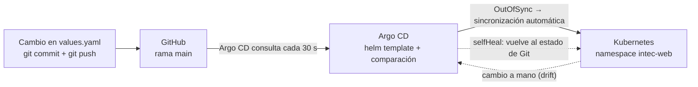

# helm-argocd-gitops

Helm chart de un servicio web (`intec-web`) que Argo CD despliega y mantiene en
un clúster de Kubernetes siguiendo GitOps: **lo que está en la rama `main` de
este repositorio es lo que corre en el clúster**.

Instituto Tecnológico de Santo Domingo (INTEC) · ING-IDS339-01 DevOps y
DevSecOps · Jose Enrique De Jesus Estevez

## Contenido

```
├── Chart.yaml              # metadatos del chart (nombre, versión)
├── values.yaml             # estado deseado: réplicas, imagen, contenido de la página
├── values.schema.json      # valida values.yaml antes de desplegar
├── templates/
│   ├── deployment.yaml     # pods de nginx sin privilegios, con sondas y recursos
│   ├── service.yaml        # NodePort 30090
│   ├── configmap.yaml      # nginx.conf + página de inicio
│   ├── serviceaccount.yaml # cuenta sin token de la API
│   ├── NOTES.txt
│   └── tests/test-conexion.yaml   # helm test
├── argocd/
│   ├── values-argocd.yaml  # valores con los que se instala Argo CD (Helm)
│   └── application.yaml    # la Application que apunta a este repositorio
└── cluster/
    └── kind-config.yaml    # clúster local: 1 nodo de control + 2 de trabajo
```

## El flujo GitOps



1. **Git es la fuente de verdad.** Para cambiar la aplicación (réplicas, versión
   de la imagen, contenido) se edita `values.yaml` y se hace commit y push. Nadie
   ejecuta `kubectl apply` ni `helm upgrade` a mano.
2. **Argo CD detecta el cambio.** Consulta el repositorio cada 30 s, renderiza el
   chart con Helm y compara el resultado con lo que hay en el clúster. Si no
   coinciden, la Application pasa a `OutOfSync`.
3. **Sincronización automática.** Con `syncPolicy.automated`, Argo CD aplica la
   diferencia: Kubernetes crea el ReplicaSet nuevo y sustituye los pods sin cortar
   el servicio (`maxUnavailable: 0`). `prune` elimina lo que se quitó de Git.
4. **Rollback desde Git.** `git revert` del commit y push: Argo CD vuelve a
   sincronizar y el clúster queda como antes. El historial de Git es el historial
   de despliegues.
5. **Autorreparación.** Si alguien cambia algo a mano en el clúster (por ejemplo,
   `kubectl scale`), `selfHeal` lo devuelve al estado de Git.

Argo CD usa Helm solo para renderizar las plantillas; quien aplica y vigila los
recursos es Argo CD, así que `helm list` no muestra este despliegue.

## Reproducirlo

Requisitos: Docker, [kind](https://kind.sigs.k8s.io/), `kubectl` y Helm.

```bash
kind create cluster --config cluster/kind-config.yaml

helm repo add argo https://argoproj.github.io/argo-helm
helm install argocd argo/argo-cd --version 10.9.6 \
  -n argocd --create-namespace -f argocd/values-argocd.yaml --wait

kubectl apply -f argocd/application.yaml
```

- Argo CD: <http://localhost:8085>, usuario `admin`; contraseña inicial:
  `kubectl -n argocd get secret argocd-initial-admin-secret -o jsonpath='{.data.password}' | base64 -d`
- Aplicación: <http://localhost:8090> (y `/info` para una línea de texto con el
  pod y la versión de nginx).

Probar el chart sin Argo CD:

```bash
helm lint .
helm install intec-web . -n prueba --create-namespace --wait
helm test intec-web -n prueba --logs
```

## Seguridad

- nginx sin privilegios (`runAsNonRoot`, usuario 101), sistema de ficheros de solo
  lectura, sin capacidades del kernel y sin escalada de privilegios.
- Imágenes con versión fijada; `values.schema.json` rechaza `latest`, réplicas
  fuera de 1-10 o un color que no sea hexadecimal.
- La cuenta de servicio no monta el token de la API de Kubernetes.
- Los puertos del clúster local solo se publican en `127.0.0.1`.
